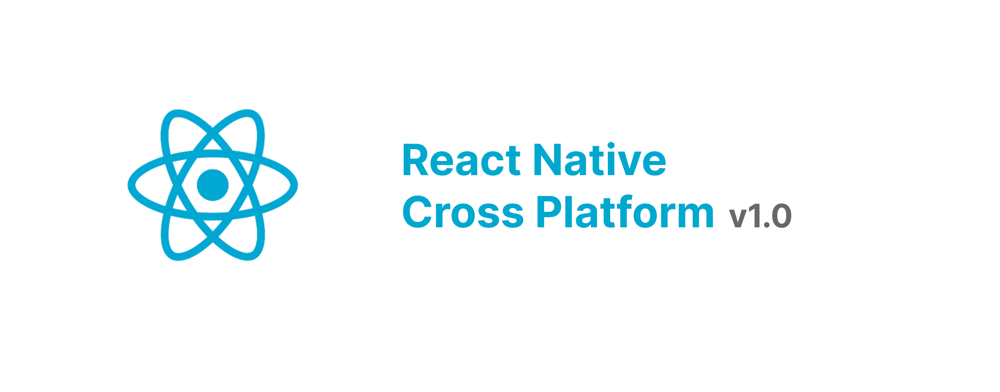

# React Native Cross-platform Apps

<p align="center">
  
</p>

Starter project for iOS, Android, macOS, Windows, Linux, and web.

## Requirements
- Node.js 22 or newer and Yarn 1.22 or newer.
- Xcode and CocoaPods for iOS/macOS development.
- Android Studio and the Android SDK for Android development.
- Windows 10/11 with the React Native Windows development dependencies and Visual Studio 2022 for Windows builds. Windows apps cannot be built on macOS.

## Install
```sh
yarn install
yarn app:dep
```

`yarn app:dep` installs CocoaPods for iOS and macOS. On Windows, install the Windows prerequisites from the [React Native Windows guide](https://microsoft.github.io/react-native-windows/docs/rnw-dependencies).

## Run
Start Metro in one terminal:
```sh
yarn app:start
```

Run a platform in another terminal:
```sh
yarn ios
yarn android
yarn macos
yarn windows
yarn web:dev
```

`yarn macos` requires macOS. `yarn windows` requires Windows and Visual Studio. For Windows packaging, open `windows/ReactNativeStarter.sln` in Visual Studio and build the Release configuration. The native desktop targets were initialized with React Native Windows' New Architecture template.

## Linux
The Linux app is the web build packaged in an Electron shell located in `linux/` (not native UI).
```sh
yarn linux:install   # install the shell's dependencies
yarn linux:dev       # build the web bundle and open it in Electron
yarn linux:build     # produce linux/dist/*.AppImage and *.deb
```
Before publishing, replace the placeholder `maintainer` in `linux/electron-builder.yml`, update `homepage` in `linux/package.json`, and add an app icon. CI (`.github/workflows/linux.yml`) builds the packages and runs a headless smoke test.

## Project Scripts
- `yarn typecheck`, `yarn lint`, and `yarn test` run the static checks and Jest suite.
- `yarn web:build` creates the web production bundle.
- `yarn ios:pod:install` and `yarn macos:pod:install` install Apple platform pods.

## Platform-Specific Files

This project uses React Native's automatic module resolution to handle platform differences. You can create platform-specific implementations of any file by adding a platform extension.

### How It Works

When you import a module, React Native automatically selects the correct file based on the build target:

```typescript
import { MyComponent } from './MyComponent';
```

React Native looks for files in this order:
1. `MyComponent.<platform>.ts(x)` - Platform-specific version
2. `MyComponent.ts(x)` - Default fallback

### Supported Platforms

- `.ios` - iOS
- `.android` - Android  
- `.macos` - macOS
- `.windows` - Windows
- `.web` - Web
- `.native` - Any native platform (iOS, Android, macOS, Windows)

### Examples

**Default component** - Works for all platforms:
```
src/screens/Home.tsx
```

**Platform-specific** - Customize for Android:
```
src/screens/Home.tsx          # Default
src/screens/Home.android.tsx  # Android-specific override
```

**Multiple platforms** - Different implementations per platform:
```
src/screens/Home.tsx          # Default fallback
src/screens/Home.ios.tsx      # iOS
src/screens/Home.android.tsx  # Android
src/screens/Home.windows.tsx  # Windows
src/screens/Home.web.tsx      # Web
```

### Common Use Cases

- **UI Components**: Different layouts, native components per platform
- **Styling**: Platform-specific spacing, fonts, colors
- **Deep Linking**: Platform-specific URL schemes and routing
- **Navigation**: Native navigation patterns per platform
- **Dependencies**: Platform-specific packages or implementations

### Best Practice

1. Create a default/base implementation: `Component.tsx`
2. For platform-specific differences, create platform overrides: `Component.ios.tsx`, `Component.android.tsx`, etc.
3. Import once, platform module resolution handles the rest

No conditional logic or platform detection needed in your imports!

## Deep Linking
Update the platform-specific linking files in `src/routes/`:
- `linking.ts` - Default/web configuration
- `linking.ios.ts` - iOS-specific configuration
- `linking.android.ts` - Android-specific configuration
- `linking.macos.ts` - macOS-specific configuration
- `linking.windows.ts` - Windows-specific configuration
- `linking.web.ts` - Web-specific configuration

See the [React Navigation deep linking guide](https://reactnavigation.org/docs/deep-linking/) for more details.

## Platforms
- iOS and Android use the React Native CLI.
- macOS uses [React Native macOS](https://microsoft.github.io/react-native-macos/docs/getting-started).
- Windows uses [React Native Windows](https://microsoft.github.io/react-native-windows/docs/getting-started/).
- Web uses React Native Web and Webpack.
- Linux wraps the web build in Electron.

## License
This project is licensed under MIT License.
